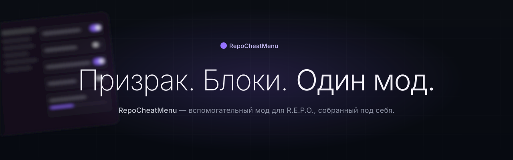

<div align="center">



**Вспомогательный мод для [R.E.P.O.](https://store.steampowered.com/app/3241660/REPO/)**
Личный проект. Приватный репозиторий. Копирайт © Kolya.

</div>

---

## Что это

Клиентский BepInEx + Harmony мод для R.E.P.O. (Unity + Mono + Photon PUN2),
собирающий в одно меню то, что помогает мне и друзьям играть и не падать от
багов игры. Делался «под себя»: часть фич — улучшения жизни (HUD, фотомод,
журнал забега, карта), часть — утилиты для гостя (телекинез, невидимка,
«призрак»), часть — вкладки с автоматизацией (блочные скрипты).

Поставляется связкой **мод + загрузчик + лаунчер модпаков**.

| Проект | Что это |
|---|---|
| [`RepoCheatMenu/`](RepoCheatMenu) | Собственно мод: Harmony-патчи, UI, HUD, фичи |
| [`RepoCheatMenu.Loader/`](RepoCheatMenu.Loader) | Загрузчик с горячей перезагрузкой ядра (без перезапуска игры) |
| [`Launcher/`](Launcher) | Консольный лаунчер `RepoLauncher.exe` для 3 модпаков (default / optimization / hd) |
| [`RepoInfiniteStrength/`](RepoInfiniteStrength) | Отдельный маленький мод, уровень силы захвата |
| [`tools/`](tools) | Скрипты сборки, обфускации, аудитa |

## Основные фичи

### Меню
- **F6** — новое меню в стиле Rockstar «Modern» (ClickGUI, Dropdown-режим, поиск).
- **Right Shift** — старое меню, функционально дублирует новое.
- Клик по кнопке — вкл/выкл, средний клик по строке — назначить клавишу.
- Автобэкап `.cfg` раз в день.

### Призрак-наблюдатель
- Ваш аватар не создаётся у других игроков — фильтр режет исходящие `202/204`
  и `200`/серилейз для видов, созданных вами.
- **Голос слышат все, без мода у них** (с v1.0.112): фильтр пропускает только один
  prefab — «Voice», это игровой голосовой PhotonView.
  `Recorder.UserData = ViewID`, у получателя `PhotonVoiceView.SpeakerInUse`
  играет 2D (без 3D-позиции, т.к. аватара рядом нет).
- Телекинез, прыжки к ценностям / грузовику / точке выхода / выбранному
  игроку, слежка глазами, статус.

### Блочные скрипты (вкладка «Блоки», F6)
Scratch-подобный редактор поведения бота. Собирай цепочку из блоков и
запускай — автозапуск, повтор, условия, переменные.

Пример скрипта «Обход серверов»:

```
Переменная "заходов" = 0
Повторить 3 раз:
    Зайти на случайный новый сервер
    Если прошлый блок удался:
        Переменная "заходов" + 1
        Ждать 60 с
        Выйти в главное меню
    Иначе:
        Прервать цикл
Если переменная "заходов" ≥ 1:
    Уведомление "Обход закончен"
Иначе:
    Уведомление "Ни одного нового сервера"
```

Доступные блоки: сеть (новый сервер / выход / ждать сцену, уровень, игроков,
смерть), мод (функция, значение, спавн предмета/ценности, телепорт,
выбрать игрока, вызов скрипта, уведомление, лог, вернуть настройки),
управление (повтор, всегда, если / иначе, с шансом, прервать, остановить).

Скрипт сохраняется в `BepInEx\config\RepoCheatMenu_Blocks\*.blk`,
черновик автосохраняется, в буфер обмена экспортируется как
`REPOBLK1 <name>\n…` — чтобы передать другу.

### HUD карточки
Порт карточек из Rockstar HUD, те же размеры в их GUI-единицах, та же
анимация pop-in. Режим редактирования — перетаскивание карточек
(порядок, положение). Карточки: Игроки, Враги, Ценности, Лут,
Пинг, Остров уведомлений.

### ESP
- Nametag-ESP с переключением стилей (Rockstar / простой).
- 3D-коробки, стрелки за экраном, круги прыжков, маркеры друзей, ESP
  ловушек, подсветка ценностей / тележек / точек выхода.
- Радужный режим, through-wall через свой chams-камеру.

### Движение / Камера
- Полёт (включая режим «мёртвый полёт»), ноклип, автоопускание при полёте.
- От третьего лица со сглаживанием (`VisionHack`), правильный aim origin
  (`ThirdPersonAimPatch` возвращает настоящий first-person pose).
- FOV, дальность отрисовки, зум, фонарик, фильтр зрения.

### Прочее
- **Поиск Steam-лобби по URL профиля**: вставить ссылку в поле → мод находит
  SteamID → сканит открытые REPO-лобби → заходит.
- **Фото-режим**: скриншоты без HUD, настройки.
- **Пресеты**: быстрое переключение наборов настроек.
- **Чат-лог**: локальная история, выключение TTS отдельного игрока.
- **Разблокировка косметики** с бэкапом `MetaSave.es3`.
- **Антикраш**: обрезание TMP rich-text в чате / именах (ломало игру).

## Как собрать

Нужен **.NET 8 SDK**.

```bash
# Чистая сборка только ядра:
cd RepoCheatMenu
dotnet build -c Release
```

Быстрее — одной кнопкой из корня репо (`Собрать и обновить.bat`):
бампает patch-версию в [`Plugin.cs`](RepoCheatMenu/Plugin.cs),
собирает core + loader + launcher, обфусцирует ядро через
Obfuscar (`tools/obfuscar.template.xml`), пишет пакет
`dist/RepoLauncher/`, копирует его на рабочий стол в
`%USERPROFILE%\Desktop\RepoLauncher\`.

Горячая перезагрузка кода без перезапуска игры:

```bash
powershell -File tools\deploy.ps1
```

(Первая установка требует закрытой игры — заменяется DLL загрузчика.)

### Чего нет в репо

Два файла нужны локально, но не распространяются по причинам
лицензии / копирайта чужих авторов:

- **`RepoCheatMenu/fonts/SFProDisplay-*.otf`** — шрифты Apple.
  См. [`RepoCheatMenu/fonts/README.md`](RepoCheatMenu/fonts/README.md).
- **`RepoCheatMenu/RockIconData.cs`** — иконки Rockstar.
  Пересобирается `tools/make-icons.py`.
  См. [`RepoCheatMenu/RockIconData.README.md`](RepoCheatMenu/RockIconData.README.md).

Без них ядро не соберётся. С шрифтами fallback возможен (Segoe UI / Arial),
а иконки захардкожены в код.

## Установка (готовая сборка)

### Через `RepoLauncher.exe`
После `Собрать и обновить.bat` на рабочем столе появляется папка
`RepoLauncher`. Запусти `RepoLauncher.exe`, выбери модпак,
нажми «Играть» — лаунчер сам поставит мод в `%LOCALAPPDATA%\RepoLauncher\profiles\<pack>\`,
запустит Steam с `--doorstop-target-assembly`.

### Руками
```
<Steam>\steamapps\common\REPO\BepInEx\plugins\local-RepoCheatMenu\
    RepoCheatMenu.core
    RepoCheatMenu.Loader.dll
    fonts\
    ...
```

### r2modman
Положить ту же папку в профиль r2modman как `local-RepoCheatMenu`.

## Горячие клавиши по умолчанию

| Клавиша | Что делает |
|---|---|
| **F6** | Открыть/закрыть новое меню |
| **RightShift** | Открыть/закрыть старое меню |
| **]** | Паник — скрыть всё, что мод рисует (включая отладочный мост) |
| **G** | Телекинез: взять / отпустить |
| **PageDown** | Включить телекинез (функцию) |

Любой другой бинд назначается средним кликом на строке в меню.

## Структура кода

Один класс — одна фича. У большинства файлов такой заголовок:
```csharp
// FeatureHack.cs — что фича делает, как устроена, какие RPC/патчи использует,
// почему именно так, что ломается если переделать.
```

Крупные центральные файлы:

- [`Plugin.cs`](RepoCheatMenu/Plugin.cs) — вход BepInEx
- [`CheatState.cs`](RepoCheatMenu/CheatState.cs) — все `ConfigEntry` (170 КБ)
- [`Patches.cs`](RepoCheatMenu/Patches.cs) — Harmony-патчи, которые не вынесены в отдельные файлы
- [`GameReflect.cs`](RepoCheatMenu/GameReflect.cs) — рефлексия с кэшем для доступа к `internal`-полям игры
- [`CustomOverlayUI.cs`](RepoCheatMenu/CustomOverlayUI.cs) + [`CustomGui.cs`](RepoCheatMenu/CustomGui.cs) — новое меню F6
- [`OverlayUI.cs`](RepoCheatMenu/OverlayUI.cs) — старое меню Right Shift
- [`BlockScripts.cs`](RepoCheatMenu/BlockScripts.cs) — интерпретатор блочных скриптов
- [`GhostObserverHack.cs`](RepoCheatMenu/GhostObserverHack.cs) — призрак + голос

## Лицензия

Код в этом репозитории **приватный** и принадлежит © Kolya, 2026.
Без разрешения автора не копировать, не публиковать, не выдавать за свою
работу. Подробности — [`LICENSE.txt`](LICENSE.txt).

Файлы, в заголовке которых стоит пометка о Rockstar, содержат порт
дизайна / чисел / иконок клиента Rockstar — эти части принадлежат их
авторам, использованы здесь по тому же принципу, что и в других
клиентских модах.

R.E.P.O. — игра **semiwork**. Мод с ней не связан, ею не поддерживается
и не одобряется.

---

<div align="center">

*собрано, задеплоено и ещё раз сломано ·
<a href="CLAUDE.md">полная история в CLAUDE.md</a>*

</div>
